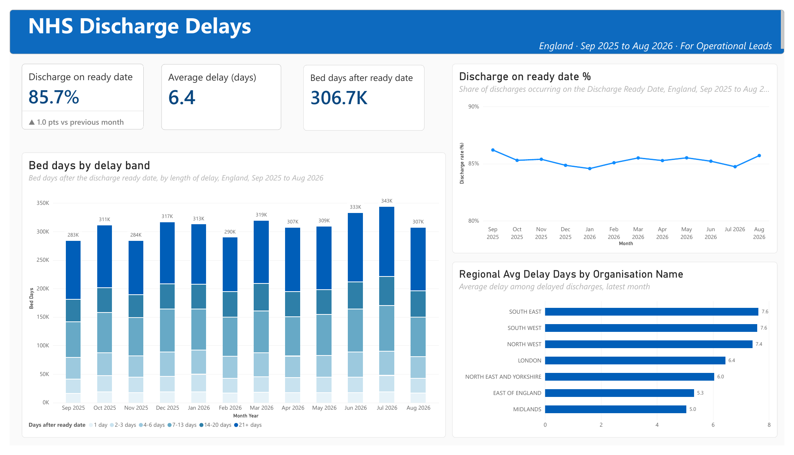
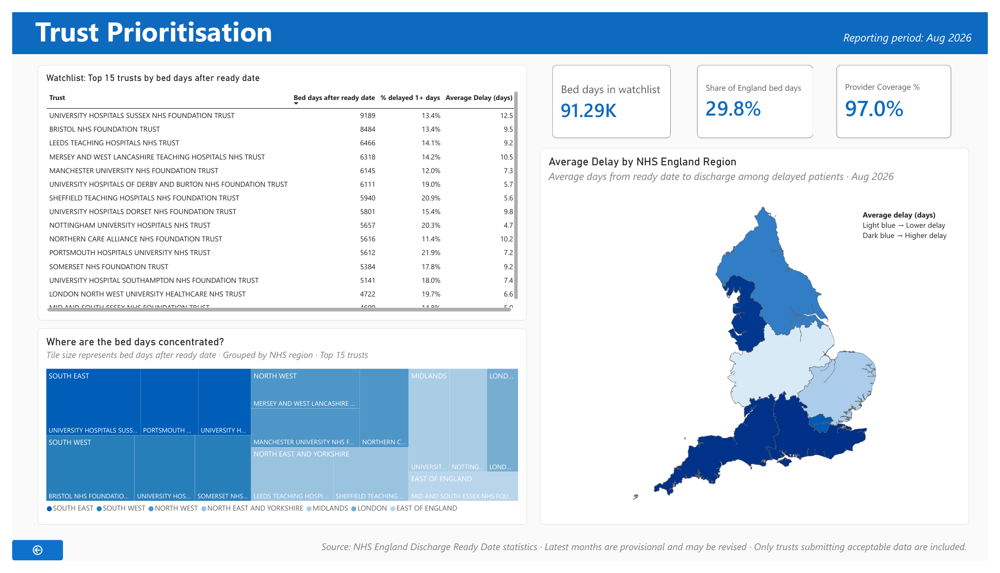

# NHS Discharge Delays Dashboard | Power BI

An interactive Power BI dashboard exploring NHS discharge delays in England, with a focus on national trends, regional variation and trust-level prioritisation.

## Project Overview

Delays in discharging patients after their Discharge Ready Date can contribute to hospital bed occupancy and operational pressure. Understanding the scale and distribution of these delays can help highlight areas for further operational investigation.

This project uses NHS England's Discharge Ready Date statistics to examine discharge-delay patterns across England and identify NHS trusts contributing the largest recorded number of bed days lost due to delayed discharge.

The report contains two pages, each designed to answer a different operational question.

## Dashboard Preview

### Page 1 — England Overview

[](screenshots/page_1_england_overview.png)


The England overview provides a national summary of discharge delays through:

* **KPI cards:** Percentage of discharges on the ready date, average delay among delayed discharges, and total bed days lost.
* **Monthly trend:** Changes in the percentage of discharges occurring on the Discharge Ready Date.
* **Delay-band breakdown:** Distribution of bed days across different delay durations.
* **Regional comparison:** Average delay across NHS England regions.

### Page 2 — Trust Prioritisation

[](screenshots/page_2_trust_prioritisation.png)

The trust prioritisation page focuses on where the recorded bed-day burden is concentrated:

* **Trust watchlist:** The 15 trusts with the highest recorded bed days lost due to delayed discharge.
* **KPI cards:** Bed days represented by the watchlist, its share of England's total, and provider data coverage.
* **Regional map:** Geographic comparison of average discharge delay across NHS England regions.
* **Treemap:** Distribution of bed days across the selected trusts, grouped by region.

Together, the pages move from a national overview to a more detailed view of trust-level operational burden.

## Key Findings

For **August 2026**, the dashboard reports:

| Indicator                                        |   Result |
| ------------------------------------------------ | -------: |
| Discharges occurring on the Discharge Ready Date |    85.7% |
| Average delay among delayed discharges           | 6.4 days |
| Total bed days lost due to delayed discharge     |   306.7K |
| Bed days represented by the 15-trust watchlist   |   91.29K |
| Watchlist share of England's reported bed days   |    29.8% |
| Provider coverage                                |    97.0% |

The watchlist represents approximately 30% of England's recorded bed-day burden, highlighting the concentration of reported delays across a subset of providers.

These figures relate to the selected reporting period and the data available when the dashboard was prepared. Recent NHS statistics may be provisional and subject to revision.

## Tools and Techniques

* **Power BI Desktop:** Dashboard development and interactive visualisation.
* **DAX:** KPI calculations, aggregations, percentage measures and trust-level metrics.
* **Power Query:** Data preparation and display-name transformations.
* **Data visualisation:** Time-series analysis, ranked comparisons, KPI cards, regional mapping and treemaps.

## Data Source

**NHS England — Discharge Ready Date statistics**

The dashboard is based on NHS England's published Discharge Ready Date data.

**Official source:** https://www.england.nhs.uk/statistics/statistical-work-areas/discharge-delays/discharge-ready-date/

The raw source files are not included separately in this repository. Refer to the official publication for the original data, definitions and accompanying documentation.

## Methodology

The dashboard brings together national, regional and provider-level statistics to present different aspects of discharge delays.

* National indicators summarise the overall scale of recorded discharge delays.
* Monthly visualisations show changes over the reporting period.
* Regional comparisons examine differences in average delay.
* The trust watchlist ranks providers by recorded bed days lost due to delayed discharge.
* The watchlist share compares the selected trusts' bed days with England's reported total.
* The treemap visualises how bed days are distributed across the selected trusts and regions.

The trust watchlist prioritises **total bed-day burden**, rather than average delay alone. This distinguishes the scale of the recorded burden from the average duration of delay.

## Limitations and Interpretation

* **Descriptive analysis:** The dashboard describes recorded patterns; it does not establish the causes of individual discharge delays.
* **Different measures:** Total bed days and average delay measure different aspects of the problem and should not be interpreted interchangeably.
* **No patient-level conclusions:** The dashboard does not provide patient-level records or explain individual circumstances and clinical complexity.
* **Provider comparisons:** Differences in recorded bed days do not, by themselves, establish that one trust performs better or worse than another.
* **Regional averages:** Regional statistics can conceal substantial variation between individual trusts.
* **Data coverage:** Provider coverage may vary across reporting periods. Coverage percentages should be interpreted according to the definition used in the source data.
* **Provisional statistics:** Recent months may be revised by NHS England.
* **Operational use:** The dashboard supports exploration and prioritisation; it does not demonstrate that a particular intervention will reduce discharge delays.

## How to View the Report

The interactive Power BI report is available in [`report/NHS Dashboard.pbix`](report/NHS Dashboard.pbix).

1. Download the `.pbix` file from this repository.
2. Open it in Power BI Desktop.
3. If prompted to locate the original source data, download the corresponding files from NHS England and update the data-source path as required.

The `.pbix` file allows users with Power BI Desktop to explore the report and inspect its measures and transformations. The GitHub repository itself does not render the report as an interactive dashboard.

## Repository Structure

```text
nhs-discharge-delays-dashboard/
├── README.md
├── report/
│   └── NHS_Dashboard.pbix
└── screenshots/
    ├── page1_england_overview.png
    └── page2_trust_prioritisation.png
```

## Author

A data analytics portfolio project demonstrating data preparation, analytical reasoning, DAX measures and dashboard design using public healthcare statistics.
